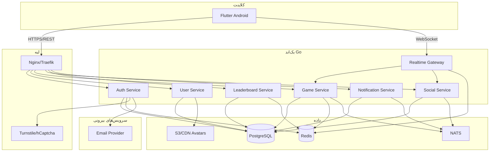
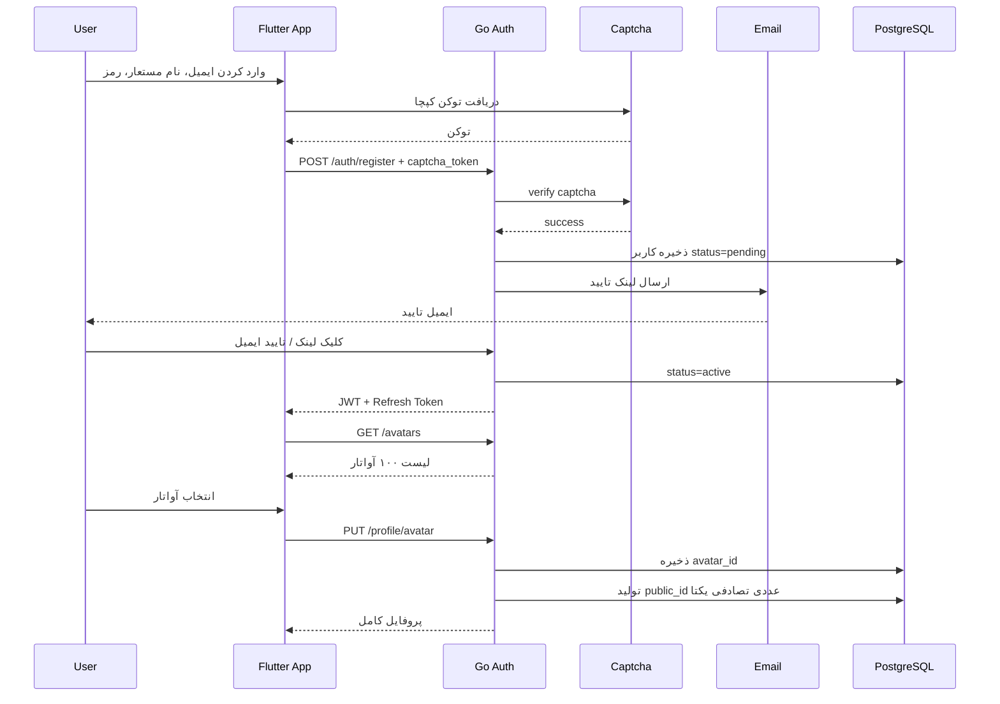
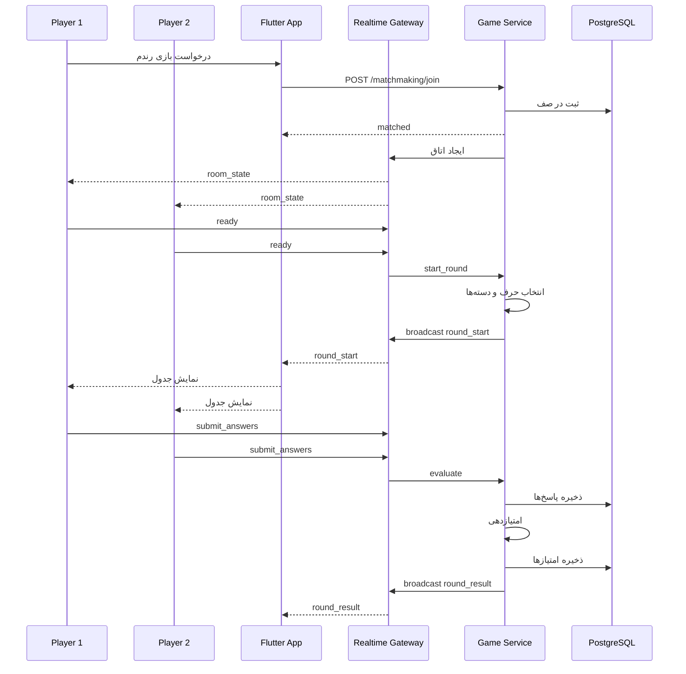
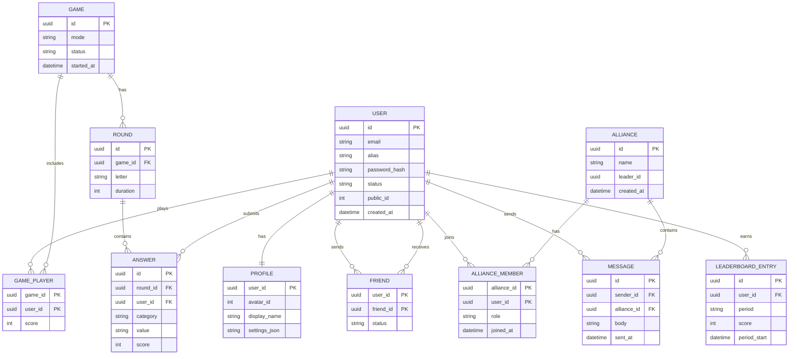
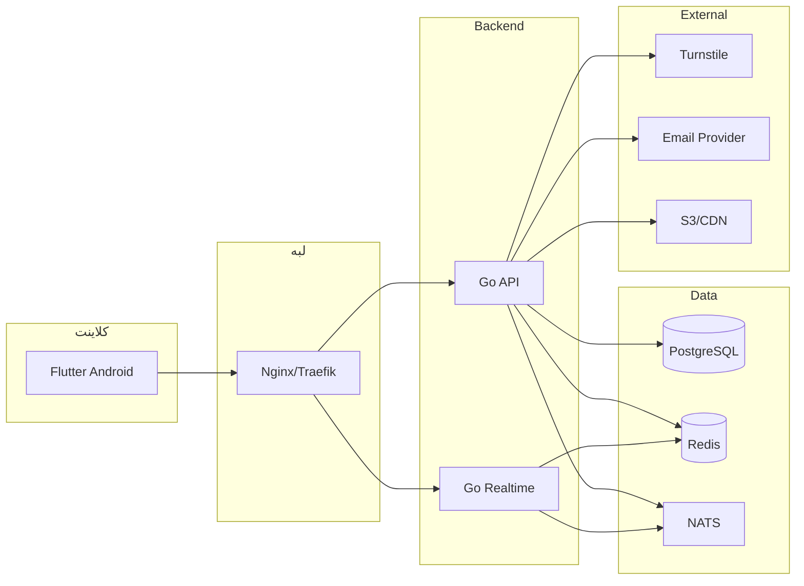
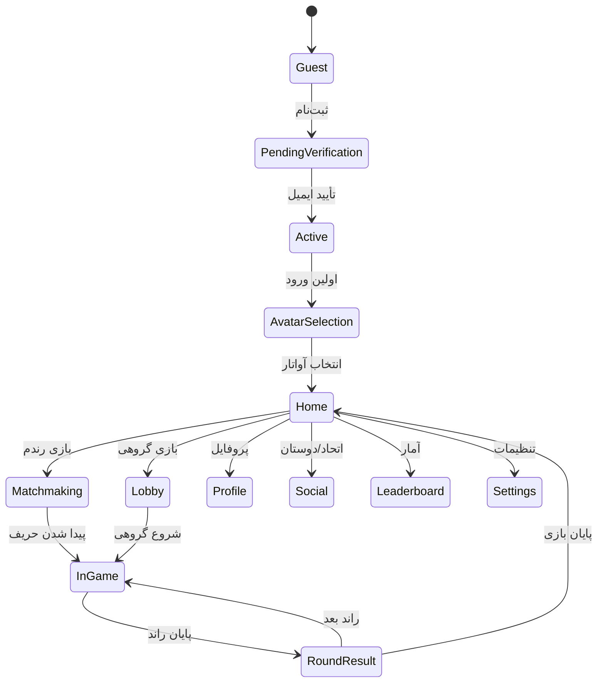
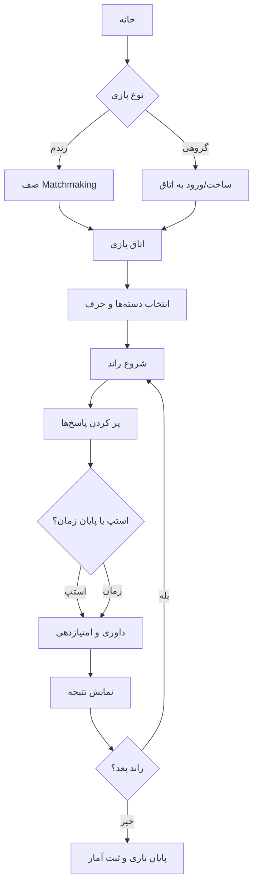

# سناریوی محصول حرفه‌ای

## بازی آنلاین اسم فامیل

**نام پیشنهادی:** اسم‌فامیل آنلاین  
**کدنام:** EsmFamil Online  
**پلتفرم فعلی:** اندروید  
**فرانت‌اند:** Flutter  
**بک‌اند:** Go  

---

## ۱. خلاصه اجرایی

اسم‌فامیل آنلاین، نسخه دیجیتال و آنلاین بازی نوستالژیک «اسم فامیل» است که با حفظ قواعد کلاسیک، امکانات اجتماعی، رقابتی و شخصی‌سازی مدرن را ارائه می‌دهد. بازیکنان می‌توانند به‌صورت تصادفی با دیگران رقابت کنند یا با دوستان و اعضای اتحاد خود بازی گروهی بسازند. هر بازیکن با ایمیل، نام مستعار و رمز عبور ثبت‌نام می‌کند، ایمیل خود را تأیید می‌کند، کپچای مدرن را رد می‌کند، یکی از ۱۰۰ آواتار را انتخاب می‌کند و یک شناسه عددی تصادفی یکتا دریافت می‌کند.

---

## ۲. ارزش پیشنهادی

- حذف کاغذ و قلم و انتقال کامل بازی به موبایل
- رقابت سریع و هیجان‌انگیز با حریف تصادفی
- بازی گروهی با دوستان، اتحاد و اتاق‌های اختصاصی
- سیستم امتیازدهی منصفانه و قابل تنظیم
- رتبه‌بندی روزانه و ماهانه
- ۱۰۰ آواتار برای شخصی‌سازی
- چت متنی، لیست دوستان و اتحاد
- تنظیمات کامل نور صفحه، صدا و اعلان‌ها

---

## ۳. مخاطب هدف

- نوجوانان و جوانان علاقه‌مند به بازی‌های کلمه‌ای
- خانواده‌ها و دورهمی‌های دوستانه
- دانش‌آموزان و دانشجویان
- کاربران بازی‌های موبایلی سبک و سریع
- طرفداران بازی‌های نوستالژیک ایرانی

---

## ۴. قواعد بازی

### ۴.۱. دسته‌بندی‌ها

دسته‌های پیش‌فرض:

- اسم
- فامیل
- میوه
- رنگ
- شهر
- کشور
- ماشین
- حیوان
- اشیا
- اعضای بدن
- نام گل
- غذا
- شغل

دسته‌ها در اتاق بازی قابل افزودن، حذف یا تغییر هستند.

### ۴.۲. حروف

- ۳۲ حرف الفبای فارسی
- حالت‌های انتخاب حرف:
  - تصادفی توسط سرور
  - چرخشی بین بازیکنان
  - انتخاب از میان حروف آسان/سخت
- حروف سخت مانند «ث، ض، ظ، ژ» در حالت‌های جداگانه قابل فعال/غیرفعال شدن هستند.

### ۴.۳. جریان راند

- سرور یک حرف را انتخاب می‌کند.
- جدول دسته‌ها نمایش داده می‌شود.
- تایمر شروع می‌شود.
- بازیکنان پاسخ‌ها را وارد می‌کنند.
- اولین بازیکنی که همه خانه‌ها را پر کند، «استپ» می‌زند.
- پس از استپ، ۱۰ ثانیه فرصت تکمیل برای بقیه بازیکنان فعال می‌شود.
- سپس پاسخ‌ها داوری و امتیازدهی می‌شوند.

### ۴.۴. امتیازدهی

- پاسخ منحصربه‌فرد و صحیح: ۱۰ امتیاز
- پاسخ صحیح ولی تکراری: ۵ امتیاز
- پاسخ صحیح و تنها پاسخ‌دهنده در آن دسته: ۲۰ امتیاز
- پاسخ خالی یا نادرست: ۰ امتیاز
- امتیازها در پایان هر راند جمع و در پایان بازی نهایی می‌شوند.

### ۴.۵. داوری

- دیکشنری داخلی برای واژه‌های شناخته‌شده
- رأی‌گیری همتا برای واژه‌های مشکوک
- محدودیت زمانی برای رأی‌گیری
- جلوگیری از تقلب با اعتبارسنجی سمت سرور

---

## ۵. نیازمندی‌های عملکردی

### ۵.۱. حساب کاربری و ورود

- ثبت‌نام با ایمیل، نام مستعار و رمز عبور
- کپچای مدرن: Cloudflare Turnstile یا hCaptcha
- تأیید ایمیل با لینک یک‌بارمصرف ۲۴ ساعته
- ورود با ایمیل و رمز عبور
- استفاده از JWT برای دسترسی و Refresh Token
- رمزنگاری رمز عبور با Argon2id
- محدودیت نرخ درخواست برای جلوگیری از حمله
- تولید شناسه عددی تصادفی یکتا برای هر بازیکن

### ۵.۲. آواتار

- ۱۰۰ آواتار در ۱۰ دسته ۱۰ تایی:
  - حیوانات
  - شخصیت‌های فانتزی
  - فضایی
  - ورزشی
  - مینیمال
  - ایرانی
  - رترو
  - طبیعت
  - اشیا
  - انتزاعی
- انتخاب آواتار پس از اولین ورود الزامی است.
- تغییر آواتار در پروفایل امکان‌پذیر است.

### ۵.۳. پروفایل

- تغییر نام نمایشی
- تغییر آواتار
- تغییر ایمیل با تأیید مجدد
- مشاهده شناسه عددی عمومی
- مشاهده آمار شخصی

### ۵.۴. تنظیمات

- نور صفحه
- صداهای بازی
- موسیقی پس‌زمینه
- اعلان‌ها:
  - دعوت به بازی
  - پیام دوستان
  - پیام اتحاد
  - پایان راند
  - تأیید ایمیل

### ۵.۵. اجتماعی

- لیست دوستان
- افزودن دوست با شناسه عددی یا نام مستعار
- درخواست دوستی، پذیرش و رد
- چت متنی با دوستان
- ساخت اتحاد
- عضویت در اتحاد
- نقش‌های اتحاد: رهبر، افسر، عضو
- چت اتحاد
- تشکیل گروه بازی از میان اعضای اتحاد

### ۵.۶. شروع بازی

- بازی آنلاین با مخاطب رندم
- بازی گروهی با دوستان یا اعضای اتحاد
- اتاق بازی با کد دعوت
- تنظیمات اتاق:
  - انتخاب دسته‌ها
  - حالت حرف
  - مدت زمان
  - نحوه امتیازدهی
- حداقل ۲ و حداکثر ۱۵ بازیکن

### ۵.۷. آمار

- ۱۰ نفر اول امروز
- ۱۰ نفر اول ماه گذشته
- آمار شخصی:
  - تعداد بازی
  - تعداد برد
  - میانگین امتیاز
  - بهترین امتیاز
  - رتبه روزانه و ماهانه

### ۵.۸. اعلان‌ها

- اعلان درون‌برنامه‌ای
- اعلان پوش با Firebase Cloud Messaging
- امکان خاموش/روشن کردن هر نوع اعلان

---

## ۶. سفر کاربر

1. نصب اپلیکیشن
2. ثبت‌نام با ایمیل، نام مستعار و رمز عبور
3. عبور از کپچای مدرن
4. دریافت ایمیل تأیید و کلیک روی لینک
5. ورود به بازی
6. انتخاب یکی از ۱۰۰ آواتار
7. دریافت شناسه عددی تصادفی
8. ورود به صفحه اصلی
9. انتخاب بین:
   - بازی رندم
   - بازی گروهی
   - دوستان و اتحاد
   - آمار
   - پروفایل
   - تنظیمات
10. شروع بازی، امتیازدهی، مشاهده نتیجه و ادامه راندها

---

## ۷. معیارهای پذیرش MVP

- ثبت‌نام و ورود با ایمیل و تأیید ایمیل انجام شود.
- کپچای مدرن در ثبت‌نام و ورود فعال باشد.
- ۱۰۰ آواتار قابل انتخاب باشد.
- شناسه عددی تصادفی یکتا برای هر کاربر تولید شود.
- پروفایل قابل ویرایش باشد.
- تنظیمات نور، صدا و اعلان ذخیره شود.
- بازی رندم ۱v۱ کار کند.
- بازی گروهی تا ۱۵ نفر کار کند.
- چت دوستان و اتحاد کار کند.
- رتبه‌بندی روزانه و ماهانه نمایش داده شود.
- امتیازدهی مطابق قواعد انجام شود.
- سرور از تقلب و دستکاری سمت کلاینت جلوگیری کند.

---

## ۸. نقشه راه

### فاز MVP

- احراز هویت
- آواتار
- پروفایل
- تنظیمات
- بازی رندم
- بازی گروهی
- دوستان
- چت
- رتبه‌بندی

### فاز دوم

- اتحاد کامل با نقش‌ها و مدیریت
- تورنمنت‌ها
- چت صوتی
- نسخه iOS
- نسخه وب
- سیستمعامل‌های دیگر
- مدل درآمدی: اشتراک ویژه، آواتارهای خاص، تبلیغات غیرمزاحم

---

# بخش فنی

### معماری کلان

### جریان ثبت‌نام و احراز هویت

### جریان بازی

### مدل داده

### استقرار

### وضعیت‌های کاربر و بازی

### جریان بازی گروهی

